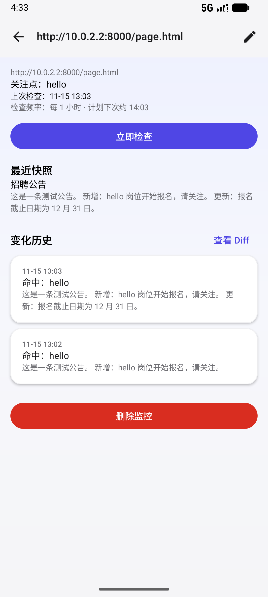
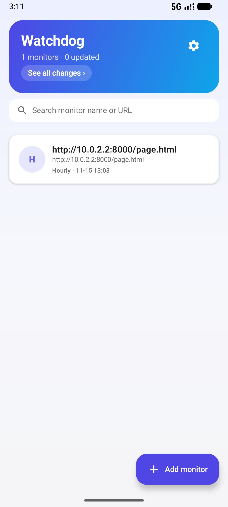

# 盯梢 · Watchdog

一个轻量的 Android 网页变化监控工具：添加要盯的页面和关注关键词，App 按你设定的频率后台检查，页面有变化时通知你，并能回看每次变化的 Diff。中英文界面，完全本地运行。

A lightweight Android app that watches web pages for changes. Add a URL and optional keywords, choose how often to check, and get notified when something changes — with a readable diff history. Bilingual UI, fully local.

<p>


</p>

---

## 功能导览 · Feature tour

### 1. 监控列表 · Monitor list


**中文**：顶部汇总监控数与未读数，可直接进入「全部变化」；卡片显示名称、URL、`每 1 小时 · 上次检查`，状态胶囊区分「有更新」和「失败」，失败时附带一行红色原因；支持搜索、下拉刷新、左滑删除（带确认）。

**English**: Counts and an all-changes shortcut at the top. Cards show name, URL, `Hourly · last check`, plus `Updated` / `Failed` chips with a one-line failure reason. Search, pull-to-refresh and confirmed swipe-to-delete are included.

### 2. 添加 / 编辑监控 · Add / edit monitor


**中文**：名称、URL（仅 http/https）、关注关键词（留空表示任何变化都提醒）、检查频率（15 分钟 / 1 小时 / 6 小时 / 每天，每个监控独立）；保存后立即执行一次基准检查。

**English**: Name, URL (http/https only), keywords (empty = any change) and a per-monitor interval (15 min / hourly / 6 h / daily). Saving runs an immediate baseline check.

### 3. 监控详情 · Monitor detail



**中文**：关注点、上次检查、检查频率与**计划下次时间**；失败时显示红色错误条；「立即检查」不受频率限制；下方是最新快照预览和变化历史。

**English**: Keywords, last check, frequency and an estimated next check; a red error banner on failure; a manual "Check now" that bypasses the interval; latest snapshot preview and change history.

### 4. 变更对比 · Diff


**中文**：逐句比较上一份与当前快照，红色 `-` 为删除、主色 `+` 为新增，命中的关键词黄色高亮；没有差异时提示这是基准快照。

**English**: Sentence-level comparison with red removals, colored additions and yellow keyword highlighting; baseline snapshots are labeled as such.

### 5. 全部变化 · All changes


**中文**：跨监控聚合最近 300 条变化，按「今天 / 昨天 / 11月15日」分组；每条显示监控名、时间、关键词胶囊和两句摘要；支持搜索，点击跳到对应监控。

**English**: Up to 300 recent events across monitors, grouped by day, each with monitor name, time, keyword chips and a snippet; searchable, and tapping opens the monitor.

### 6. 语言切换 · Language


**中文**：中文 / English / 跟随系统，立即生效；通知标题、渠道名、错误信息和日期分组同步本地化。

**English**: Chinese / English / system, applied instantly; notification titles, channel names, error messages and date groups are localized too.

### 7. 英文界面 · English UI



**中文**：英文下的列表与状态展示，包含单复数处理（1 monitor / 2 monitors）。

**English**: The list in English, including simple pluralization (1 monitor / 2 monitors).

---

## 技术栈 · Tech stack

- Kotlin 2.0 + Jetpack Compose (Material 3)
- Room 2.7（v2，含迁移）+ KSP
- WorkManager 周期任务（系统最小 15 分钟）+ OkHttp + Jsoup
- 通知渠道 + 合并通知
- MVVM + StateFlow

## 工作原理 · How it works

1. Worker 每 15 分钟唤醒一次；
2. 只检查「上次检查时间 + 自己的频率」已到期的监控；
3. 抓取 HTML → 提取正文 → 与上一份快照比较哈希；
4. 有变化时保存快照、生成逐句 Diff、匹配关键词；
5. 命中关键词则发通知（多个合并），失败则记录原因。

Worker wakes every 15 minutes, filters monitors by their own interval, fetches HTML, extracts text, compares a hash with the latest snapshot, stores a change event and notifies on keyword hits (merging multiple changes into one notification).

## 构建 · Build

```bash
# 需要 JDK 17 与 Android SDK 36
./gradlew assembleDebug
```

## 已知限制 · Limitations

- 不执行 JavaScript：纯前端渲染的页面可能抓不到正文
- 不支持登录态 / Cookie / 验证码
- 系统限制周期任务最小 15 分钟，实际触发可能有延迟
- 无云同步，数据仅在本机

- No JavaScript execution, so JS-rendered pages may yield empty content
- No login / Cookie / captcha support
- Android limits periodic work to a 15-minute minimum; delivery may be delayed
- Local only, no cloud sync

## License

MIT
