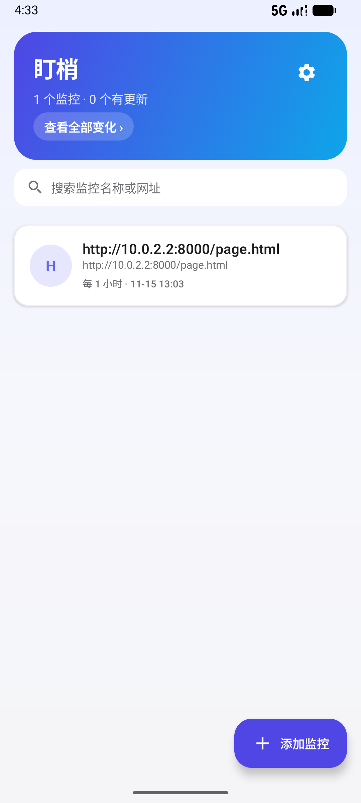
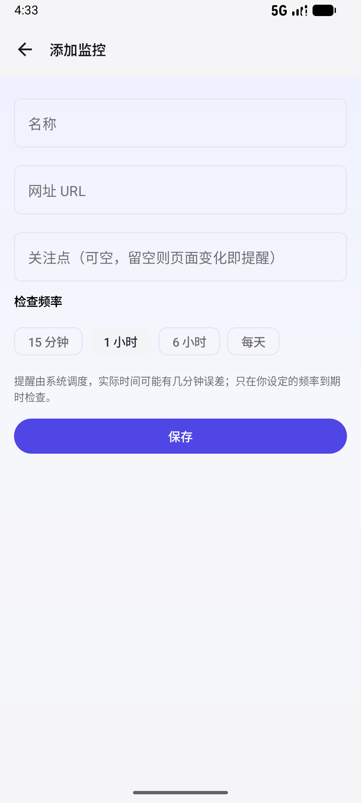
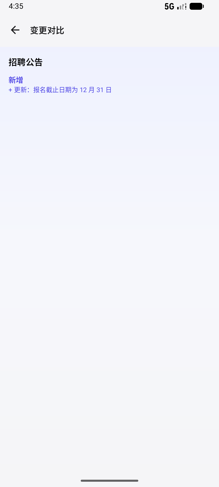
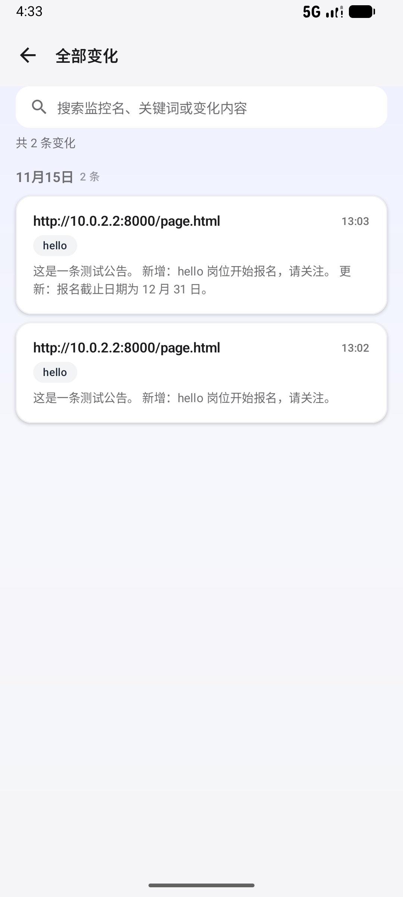
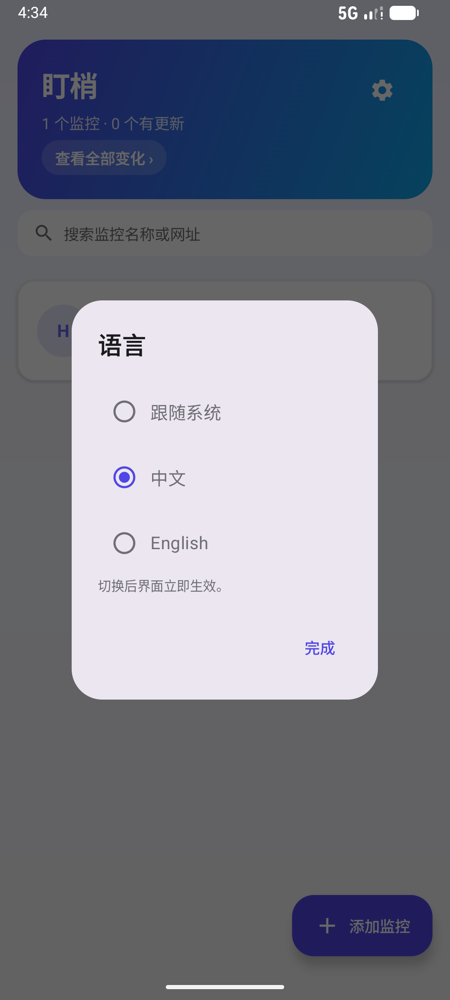

# 盯梢 · Watchdog

一个轻量的 Android 网页变化监控工具：添加要盯的页面和关注关键词，App 按你设定的频率后台检查，页面有变化时通知你，并能回看每次变化的 Diff。中英文界面，完全本地运行。

A lightweight Android app that watches web pages for changes. Add a URL and optional keywords, choose how often to check, and get notified when something changes — with a readable diff history. Bilingual UI, fully local.

<p>


</p>

---

## 中文

### 使用场景

- 学校/政府/招聘网站发布新公告
- 商品价格、库存、活动页变化
- 服务状态页、文档更新
- 任何“我不想天天刷，但一有变化要第一时间知道”的网页

### 功能

| 模块 | 说明 |
|---|---|
| 监控管理 | 名称、URL、关注关键词，启停、编辑、左滑删除（带确认） |
| 检查频率 | 每个监控独立设置：15 分钟 / 1 小时 / 6 小时 / 每天 |
| 正文提取 | Jsoup 去除脚本/样式/导航，优先 article/main 正文 |
| 关键词 | 命中关键词才提醒；留空则任何页面变化都提醒 |
| 变化通知 | 单条变化单独通知；一轮多个变化合并成一条，避免轰炸 |
| Diff | 逐句对比新增/删除，关键词黄色高亮 |
| 全部变化 | 跨监控时间线，按今天/昨天/日期分组，可搜索 |
| 失败可见 | 抓取失败/无可提取正文会记录原因并在列表/详情显示 |
| 中英文 | 中文 / English / 跟随系统，通知与日期同步本地化 |

### 截图

| 监控列表 | 添加监控 | 监控详情 |
|---|---|---|
|  |  |  |

| 变更对比 | 全部变化 | 语言切换 |
|---|---|---|
|  |  |  |

英文界面：


### 技术栈

- Kotlin 2.0 + Jetpack Compose (Material 3)
- Room 2.7（v2，含迁移）+ KSP
- WorkManager 周期任务（系统最小 15 分钟）+ OkHttp + Jsoup
- 通知渠道 + 合并通知
- MVVM + StateFlow

### 构建

```bash
./gradlew assembleDebug
```

需要 JDK 17 与 Android SDK 36。

### 工作原理

1. Worker 每 15 分钟唤醒一次；
2. 只检查「上次检查时间 + 自己的频率」已到期的监控；
3. 抓取 HTML → 提取正文 → 与上一份快照比较哈希；
4. 有变化时保存快照、生成逐句 Diff、匹配关键词；
5. 命中关键词则发通知（多个合并），失败则记录原因。

### 已知限制

- 不执行 JavaScript：纯前端渲染的页面可能抓不到正文
- 不支持登录态/Cookie/验证码
- 系统限制周期任务最小 15 分钟，实际触发可能有延迟
- 无云同步，数据仅在本机

### License

MIT

---

## English

### What it is for

Announcements, job postings, price drops, status pages, documentation updates — anything you don't want to refresh manually but want to know about immediately.

### Features

- Per-monitor configuration: name, URL, keywords, enabled switch
- Per-monitor interval: 15 min / 1 h / 6 h / daily (WorkManager wakes every 15 min and only checks due monitors)
- Readable text extraction (Jsoup; prefers `article`/`main`, strips scripts/nav)
- Keyword matching; empty keywords means "any change"
- Notifications: one per change, or a single merged summary when several monitors change in one run
- Diff view with sentence-level additions/removals and keyword highlighting
- Cross-monitor "all changes" timeline grouped by day, searchable
- Failure surfacing: fetch/extraction errors are stored and shown in the list/detail
- Chinese / English / system language

### How it works

Worker wakes every 15 minutes → filters monitors by their own interval → fetches HTML with OkHttp → extracts text with Jsoup → compares a content hash with the latest snapshot → saves snapshot/change event → sends notifications for keyword hits.

### Screenshots

See the tables above.

### Build

```bash
./gradlew assembleDebug
```

JDK 17 + Android SDK 36.

### Limitations

- No JavaScript execution, so JS-rendered pages may yield empty content
- No login/Cookie/captcha support
- Android limits periodic work to a 15-minute minimum; delivery may be delayed
- Local only, no cloud sync

### License

MIT
